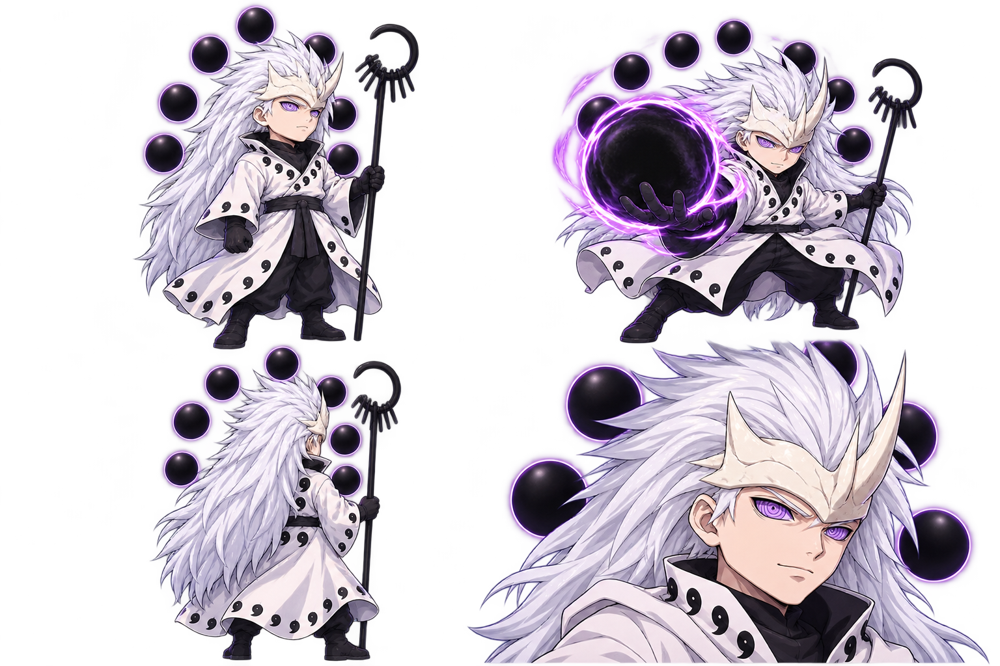
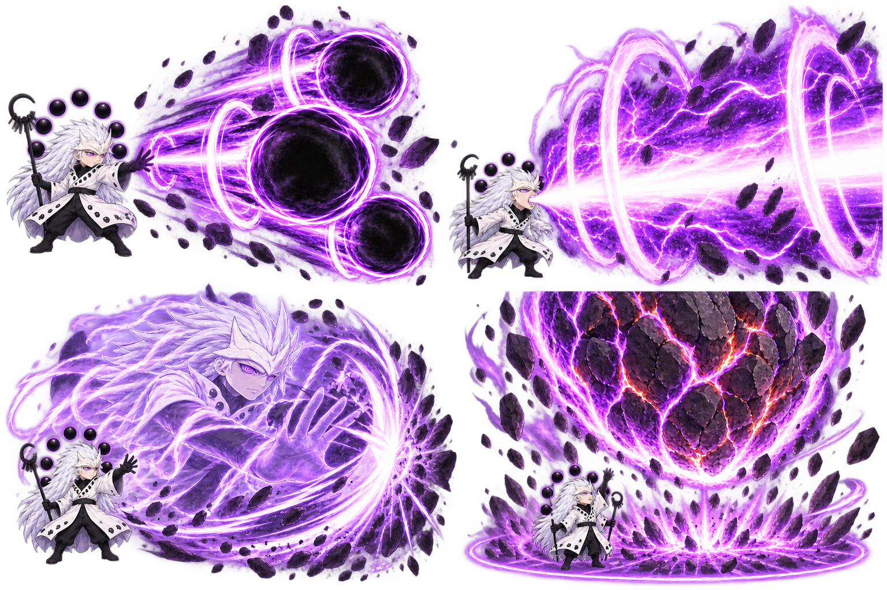
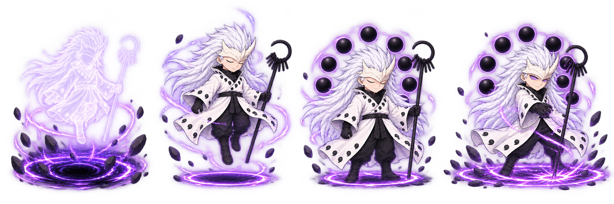

# Madara Lục Đạo — bản thiết kế hình ảnh

Tạo hình theo phong cách chibi chi tiết và góc nhìn hơi từ trên xuống của Gojo v2: tóc trắng dài, mắt Rinnegan tím, áo choàng Lục Đạo trắng với dấu magatama đen, tích trượng đen và Cầu Đạo Ngọc sau lưng.

Madara đã được triển khai vào game. Ba ảnh concept/storyboard là tham khảo thiết kế; sáu sheet hành động, cast, intro, VFX, Ultimate và dialogue đã được tách thành84 frame gốc và8 atlas WebP chạy game. Xem [chi tiết triển khai](../../../docs/MADARA.md).

## Tạo hình

## Hướng kỹ năng đã chốt

- **Cầu Đạo Ngọc:** ba cầu đen lớn phóng liên tiếp, lõi đen rõ, viền tím và đuôi lực xoáy; quả đạn lớn gần bằng thân nhân vật.
- **Lam Độn – Quang Nha:** tia sáng tím dài, lõi trắng sáng, vòng sóng lớn tại điểm phát và vệt cắt rõ.
- **Luân Mộ:** bóng Madara bán trong suốt, mắt tím và dư ảnh mạnh, đòn đánh có vòng xung kích lớn.
- **Thiên Ngại Chấn Tinh:** vòng cảnh báo trên sàn, thiên thạch khổng lồ rơi xuống, đá vỡ và sóng va chạm rộng. Câu hô Ultimate dự kiến ngắn1–1,5 giây.
- Nội tại dự kiến: dưới40% HP, tăng20% tốc độ hồi kỹ năng đến hết trận.

Thứ tự ô: trên trái Cầu Đạo Ngọc, trên phải Quang Nha, dưới trái Luân Mộ, dưới phải thiên thạch.

Ưu tiên cảm giác chiêu to và có sức nặng bằng kích thước, tương phản, đuôi chuyển động và sóng va chạm. Khi dựng sprite thật, tách nhân vật khỏi hiệu ứng để khuôn mặt và động tác không bị che.

## Màn xuất hiện khoảng2,5 giây

1. Bóng đen tụ dưới đất, đá nhỏ nhấc lên.
2. Madara hạ xuống, tóc và áo choàng chuyển động.
3. Cầu Đạo Ngọc xuất hiện thành vòng cung sau lưng.
4. Mở mắt Rinnegan, chạm tích trượng xuống sàn tạo vòng sóng tím mỏng, chuyển sang tư thế chiến đấu.

Ảnh gốc tạo bởi công cụ sinh ảnh, được giữ để tham khảo và chỉnh sửa ở các bước tiếp theo. Không thay thế tài nguyên Gojo v2 hiện tại.
